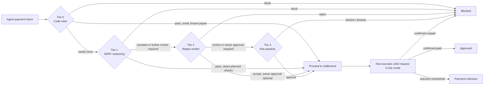

<div align="center">


# Tripwire

**A policy gateway for AI agent payments on Kite.**

Tripwire checks whether an x402 purchase fits the agent’s task before Kite spends USDC. Every decision includes a receipt with the checks, reasons and costs.

[](https://github.com/drained69/Tripwire/actions/workflows/ci.yml)


[](LICENSE)

[Hosted preview](https://tripwirev1.up.railway.app) · [Try the demo](#run-the-demo) · [Payment evidence](#hackathon-evidence) · [API](docs/api.md)

</div>

## Hackathon evidence

Built for the [OpenServ SERV Hackathon Edition 02, Kite track](https://www.openserv.ai/hackathon-2). The recorded build-period history starts with [the November 8 import](https://github.com/drained69/Tripwire/commit/38552a9) and runs through [the November 11 preview change](https://github.com/drained69/Tripwire/commit/61eb8e6), within the November 2–15 event window. The first commit imports the core implementation in one batch.

| What happened on November 8, 2026 (UTC) | Evidence | Code |
|---|---|---|
| **19:25 · $0.001 USDC paid on Base.** The merchant price and directory checks ran, SERV passed the request, Kite settled it and the merchant returned HTTP 200. | [Base transaction](https://basescan.org/tx/0xba29d76792d5de4b498d48f38daa73f9d3a221ceee9029be530935177da872bc) · SERV request `e54a9700-ae31-492c-95af-343c4018515b` | [Price check](src/adapters/x402.ts) · [Kite adapter](src/adapters/kite.ts) |
| **19:33 · Live Reppo verdict blocked a payment.** SERV passed the request, then Reppo returned `block` with a score of 75. There was no settlement. | Recorded SERV request `a3b124ef-0dae-4492-b8ab-4d545271666a` · Reppo evaluation `cmw88d9h2000008l8yb3aq1a5` | [SERV check](src/tiers/tier1Serv.ts) · [Reppo adapter](src/tiers/tier2Reppo.ts) · [Routing](src/engine.ts) |

The hosted visitor flow previews one fixed request with settlement disabled. The scripted demo is reproducible offline, and the Kite passkey path was exercised against a simulated CLI. The records above are from separate live runs.

<div align="center">

<br />


</div>

---

## Table of contents

- [About](#about)
- [Hackathon evidence](#hackathon-evidence)
- [Features](#features)
- [How it works](#how-it-works)
- [Getting started](#getting-started)
- [Usage](#usage)
- [Configuration](#configuration)
- [Sponsor integrations](#sponsor-integrations)
- [Results](#results)
- [Project structure](#project-structure)
- [Testing](#testing)
- [Documentation](#documentation)
- [Roadmap](#roadmap)
- [Contributing](#contributing)
- [Security](#security)
- [License](#license)
- [Acknowledgments](#acknowledgments)

## About

Kite Agent Passport gives AI agents a standing allowance for purchases such as API calls. A purchase can fit within that allowance and still be risky. An invoice can point to a lookalike domain, ask an agent to change the payment destination, or split one charge into several smaller requests. [Kite](https://gokite.ai)

Tripwire sits between your agents and their Kite allowance. Every payment climbs a ladder of checks that gets stricter as more money is at risk, from free code rules up to the owner's passkey, and every decision comes with a receipt showing what ran, what it cost and why.

Tripwire is for teams running agents that already buy API calls through Kite. The team gives agents a Tripwire MCP or HTTP credential and keeps the Kite payment credential on the gateway. The gateway checks purchase context and keeps application receipts. Kite supplies the delegated spending authority and settles approved x402 requests in USDC. Agents with independent Kite credentials can bypass the gateway.

A managed deployment for teams that need shared policy and audit history is a possible paid offering. Current costs and review burden are measured in the [SERV benchmark and synthetic replay](#results).

## Features

- **Tiered verification**: deterministic rules → OpenServ SERV reasoning → Reppo network verdict → Kite passkey step-up. Cheap checks run on everything; expensive ones only where the risk is.
- **Fail-closed verification**: a block stops the payment. Unconfirmed live checks escalate, and an unexpected error before settlement stops execution.
- **Attack detection**: lookalike payees, prompt injection in vendor text, duplicate and split payments, unusual amounts, and payees missing from Kite's service directory.
- **Retry protection**: the same agent and `requestKey` return the original receipt. The gateway saves a Kite idempotency key before execution and reuses it when rechecking an unresolved payment.
- **Plain-English policy**: write rules like *"Never pay more than $25 to a new vendor"*. SERV compiles them, code validates them, and you approve the exact diff.
- **Learns from you and Reppo**: trusted payees earn fewer interruptions; report a paid payment as a problem and you approve that payee for 30 days while its agent gets stricter checks; Reppo's agreement with your decisions is tracked on the dashboard.
- **Receipts for every decision**: a timeline of each check, its cost, latency, whether it ran `live` or `mock`, and the sponsors' own evidence: SERV request ids, Reppo evaluation ids, Kite transaction hashes.
- **Agent-ready**: a dependency-free MCP server (`tripwire_pay`, `tripwire_receipt`, `tripwire_policy`) and a JSON HTTP API.
- **Live dashboard**: decisions in real time, allowance and cost metrics, payee trust, policy editor and replay chart, in light and dark themes.
- **Zero runtime dependencies**: TypeScript in strict mode, run directly by Node with no build step.

## How it works



The table shows the default demo thresholds. Live deployments set their own thresholds in policy. Reppo can run below its amount threshold when earlier checks flag risk.

| Tier | Runs when | Checks | Cost |
|---|---|---|---|
| **0 · Code rules** | Every payment | Caps, allow/deny lists, your rules, lookalikes, duplicates, splits, unusual amounts, injected instructions, Kite directory | ~$0 |
| **1 · SERV reasoning** | ≥ $1 or a new payee | Does the purchase follow from the agent's task? (SERV Multipath + Kronos reasoning graph, PromptGuard, Shadow Agent) | ~$0.0008 |
| **2 · Reppo verdict** | ≥ $20, a serious flag, or SERV escalates | A panel of independent evaluators scores the payment and routes it ship / review / block | 440 credits ($0.22) |
| **3 · Kite passkey** | Reppo escalates, the price can't be confirmed, or the owner previously flagged the payee | The owner approves a one-shot session capped at the requested amount | Owner interaction |

Full details on routing, each tier and calibration: **[docs/how-it-works.md](docs/how-it-works.md)**.

## Getting started

### Prerequisites

- [Node.js](https://nodejs.org) **23.6 or newer** (the repository's `.nvmrc` pins 24)
- Optional, for real payments only: Kite's `kpass` CLI 6.8.9+ ([deployment guide](docs/deployment.md))

### Installation

```bash
git clone https://github.com/drained69/Tripwire.git
cd Tripwire
```

Node runs the TypeScript sources directly. Install development dependencies with `npm ci` when you want to type-check.

### Run the demo

```bash
npm start
```

Open **http://127.0.0.1:8787** and press **Run next demo payment**. Three agents share a simulated $100 allowance across seven scripted requests.

1. Open the first receipt to see code rules approve a $0.40 request to a known payee.
2. Advance to the third request, a $60 invoice to `acme-bi11ing.example`. Decline the simulated owner approval, then open the receipt to see the lookalike flag, the simulated PromptGuard escalation, and Reppo's simulated review verdict.
3. Advance once more to see the matching invoice to `acme-billing.example` approved in the scripted flow.

The scripted demo needs no accounts, keys or money. To replay it in a terminal with all external integrations disabled, even when your checkout has a configured `.env`, run:

```bash
KITE_MODE=mock SERV_API_KEY= REPPO_API_KEY= REPPO_CREDIT_TOKEN= npm run demo
```

The terminal demo auto-declines owner approvals. Use **Reset demo** in the browser to clear saved demo receipts and replay the sequence. [All seven scenarios](docs/how-it-works.md#the-stage-demo)

## Usage

### Commands

| Command | Description |
|---|---|
| `npm start` | Start the dashboard and API on `http://127.0.0.1:8787` |
| `npm run demo` | Run the scripted stage demo in the terminal |
| `npm run replay` | Run the six-week calibration replay (offline) |
| `npm run mcp` | Start the MCP server for agents |
| `npm run doctor` | Check a live setup without paying anything |
| `npm test` | Run the test suite |
| `npm run typecheck` | Strict TypeScript check (after `npm install`) |
| `npm run check` | Type-check, then test (what CI runs) |

### Connect an agent

The MCP server runs over stdio and forwards requests to the running Tripwire gateway. From the repository root, register it with Claude Code:

```bash
claude mcp add tripwire \
  --env TRIPWIRE_URL=http://127.0.0.1:8787 \
  -- node "$PWD/src/mcp.ts"
```

This command targets the open local demo. For an authenticated gateway, set `TRIPWIRE_URL` to the deployment URL and add `--env TRIPWIRE_AGENT_KEY="$AGENT_KEY"` before `--`.

| Tool | Use |
|---|---|
| `tripwire_pay` | Submit an intent and wait for a decision or return a pending receipt. |
| `tripwire_receipt` | Check an existing request by receipt ID, including one awaiting the owner's passkey. |
| `tripwire_policy` | Read the agent's caps, payee rules and remaining allowance. |

### Submit a payment over HTTP

With the open local demo running, submit this sample invoice:

```bash
curl -X POST http://127.0.0.1:8787/api/intents \
  -H 'Content-Type: application/json' \
  -d '{
    "agentId": "ops-agent",
    "requestKey": "invoice-1042",
    "agentTask": "Pay approved vendor invoices for the Acme Design brand refresh project",
    "payee": "acme-billing.example",
    "payeeName": "Acme Design (billing)",
    "amountUsd": 60,
    "category": "design invoice",
    "purpose": "Invoice #1042 for brand refresh milestone 2"
  }'
```

The response is `202 { "id": "…", "receipt": "/api/receipts/…" }`. Read the receipt URL from the response or open `/r/<id>` in the dashboard. The owner's feed streams changes over server-sent events. For an authenticated gateway, send `Authorization: Bearer $AGENT_KEY`. The key determines the agent identity. Live requests also require the merchant's HTTPS x402 `url` and accept `method`, `headers`, and `body`. [API reference](docs/api.md)

### Read a receipt

Each receipt shows the status, the checks that ran, their reasons, latency and cost, and any sponsor identifiers returned. For a live settlement, look for `payment.mode: "live"` and `payment.state: "paid"`. When Kite supplies them, the receipt includes the chain ID, transaction hash, and merchant HTTP status. A public preview can approve the checks without setting a payment result.

A `payment_unknown` receipt still counts against the allowance. The owner can recheck it with Kite using the original idempotency key, or resolve it after confirming the outcome in Kite Activity. Treat a pending result as the same purchase and follow its receipt. A repeat submission with the original `requestKey` returns the existing decision.

### Write policy in plain English

In the dashboard's **Plain-English policy** panel:

> Never pay more than $25 to a new vendor. Block payments to fastcash.example. Only pay invoices on weekdays.

Tripwire shows exactly what will change (a $25 cap for new payees, `fastcash.example` blocked) and what it can't express (the weekday rule). Nothing applies until you approve.

## Configuration

Copy the example file and fill in only what you need. Every integration is optional in the demo.

```bash
cp .env.example .env
```

| Variable | Default | Description |
|---|---|---|
| `SERV_API_KEY` | — | Enables live SERV checks (tier 1) and the live policy compiler |
| `REPPO_API_KEY` or `REPPO_CREDIT_TOKEN` | — | Enables live Reppo verdicts (tier 2). An API key from eval.reppo.xyz comes with free sign-up credits |
| `KITE_MODE` | `mock` | Set to `kpass` for real payments through Kite |
| `TRIPWIRE_OWNER_TOKEN` | — | Dashboard sign-in. Required for live mode and for non-loopback binds except `PUBLIC_DEMO`. |
| `TRIPWIRE_AGENT_KEYS` | — | `agentId:key,…`. Required for private live mode. |
| `POLICY_FILE` | — | Starting policy for live mode (see `policy.example.json`) |
| `PUBLIC_LIVE` | `false` | Runs live checks on a fixed public request with a separate demo policy and in-memory receipts. Settlement and passkey approval are disabled for the preview. |
| `PORT` / `HOST` | `8787` / `127.0.0.1` | Where the server listens |

For live use, fund a Kite wallet and configure an allowance or a scoped session, set `KITE_MODE=kpass`, supply a policy and credentials, then run `npm run doctor` before starting the server. Keep Tripwire's allowance at or below Kite's allowance. Give agents separate Tripwire keys and keep Kite credentials on the gateway. [Live setup and configuration reference](docs/deployment.md)

## Sponsor integrations

| Sponsor | Used for | Status |
|---|---|---|
| **OpenServ SERV** | Tier 1 reasoning through SERV's graph features (**Multipath**, audited by **Kronos**), strict JSON schema, **PromptGuard**, **Shadow Agent**, reasoning effort; the plain-English policy compiler; a benchmark (`npm run serv:bench`) | ✅ Verified live, benchmarked |
| **Reppo** | Tier 2 panel evaluation (`/api/v1/agents/evals` or `/api/v1/x402/evals`): score 0–100, route ship / review / block; its track record against the owner feeds the dashboard | Live block recorded in [hackathon evidence](#hackathon-evidence) |
| **Kite** | Payments with `kpass session execute` and idempotency keys; passkey step-up sessions; `ksearch` service catalog; transaction hashes from `kpass activity` | Live allowance settlement on Base. Passkey step-up tested with a simulated CLI |

Evidence for each: [docs/architecture.md](docs/architecture.md#integration-status).

## Results

A six-week replay of seeded traffic (46 payments a week across three agents, 5 of them bad), run with and without calibration:

| | With calibration | Without |
|---|---|---|
| Bad payments blocked | **30 / 30** | 30 / 30 |
| Legitimate payments blocked | **0** | 0 |
| Owner interruptions on legitimate payments | **4** | 14 |
| Cost of checks at modeled live prices | $32.30 | $29.66 |

In this replay, calibration cut interruptions from 14 to 4 and added $2.64 in modeled check costs. Reproduce with `npm run replay`. The replay measures routing and calibration using offline stand-ins for SERV and Reppo. [More on the methodology](docs/how-it-works.md#results).

**Live SERV benchmark.** Ten labelled payments (five fine, five not: off-task purchases, an injected invoice, changed payment details), each run twice through the live tier-1 check:

| SERV setting | Correct | Risky examples passed by Tier 1 | Benign examples escalated by Tier 1 | Median latency | Cost (20 checks) |
|---|---|---|---|---|---|
| Plain SERV | 18 / 20 | **0** | 2 | 7.7 s | $0.018 |
| SERV Multipath + Kronos (default) | 17 / 20 | **0** | 3 | 6.4 s | $0.017 |

In this sample, both settings escalated or blocked all risky examples. Multipath + Kronos was faster in the recorded run and escalated one additional benign example. This benchmark calls Tier 1 directly, so its escalation counts measure SERV decisions before Reppo or owner review. Reproduce with `npm run serv:bench`, which consumes SERV credit.

## Project structure

```text
tripwire/
├── src/
│   ├── server.ts           HTTP API, server-sent events, static pages
│   ├── engine.ts           the verification ladder and payment flow
│   ├── tiers/              tier 0 rules, tier 1 SERV, tier 2 Reppo
│   ├── adapters/           Kite (kpass, ksearch) and the x402 price check
│   ├── auth.ts             owner sign-in and agent API keys
│   ├── policyCompiler.ts   plain-English policy → validated rules
│   ├── calibration.ts      per-payee threshold learning
│   ├── mcp.ts              MCP server for agents
│   └── …                   config, validation, types, replay, demo scenarios
├── public/                 dashboard, receipt and docs pages
├── scripts/                demo, replay and doctor commands
├── test/                   node:test suites
├── docs/                   detailed documentation
└── video/                  Remotion project for the demo video
```

Full layout with every file: [docs/architecture.md](docs/architecture.md#project-layout).

## Testing

```bash
npm ci
npm run check
```

The suite covers tier routing, calibration, sponsor response handling, price checks, authentication, concurrent payments, and public preview isolation. Tests use loopback HTTP stubs and a simulated `kpass` CLI. CI runs type-checking, tests, the offline stage demo, and the replay on Node 24 and 25. [Development guide](docs/development.md)

## Documentation

| Guide | Contents |
|---|---|
| [How it works](docs/how-it-works.md) | The ladder, routing rules, each tier, calibration, plain-English policy, the stage demo, results |
| [Architecture and security](docs/architecture.md) | Component and sequence diagrams, design choices, security model, integration status |
| [API and agent integration](docs/api.md) | MCP tools, HTTP endpoints, intent fields, receipt format |
| [Deployment and configuration](docs/deployment.md) | Going live with real Kite payments, what protects the money, all variables |
| [Development](docs/development.md) | Tooling, CI, test coverage, known limitations |

The running server also serves documentation at `/docs`.

## Roadmap

- [x] Four-tier verification ladder with receipts
- [x] SERV reasoning with Multipath, Kronos, PromptGuard and Shadow Agent, and a benchmark
- [x] Reppo panel verdicts on the current API, with a track record against the owner
- [x] Kite payments, passkey step-up and directory checks, with a first real payment on Base
- [x] Plain-English policy, calibration and owner feedback, MCP server, dashboard
- [ ] A live passkey step-up and a live Reppo verdict on the same real payment
- [ ] Cache verdicts for repeat (payee, purpose) pairs to cut latency
- [ ] Multiple owners, roles and a database backend

Known limitations are listed in [docs/development.md](docs/development.md#limitations-and-roadmap).

## Contributing

Contributions are welcome. Please read [CONTRIBUTING.md](CONTRIBUTING.md) for the development setup and pull request checklist, and run `npm run check` before opening a pull request.

## Security

Tripwire enforces policy for requests routed through its gateway. It binds each API key to one agent, checks the merchant URL and live x402 quote when applicable, and records unresolved payment outcomes against the allowance. The reasoner uses the task and purchase context supplied with the intent. The operator controls who gets an agent key, which rules apply, and which Kite credentials stay on the gateway. [Threat model](docs/architecture.md#security-model)

Report vulnerabilities privately using the instructions in [SECURITY.md](SECURITY.md).

## License

Distributed under the MIT License. See [LICENSE](LICENSE).

## Acknowledgments

- [OpenServ](https://openserv.ai) for SERV reasoning, PromptGuard and Shadow Agent
- [Reppo](https://reppo.xyz) for the Eval API
- [Kite](https://gokite.ai) for Agent Passport and the `kpass` / `ksearch` CLIs
